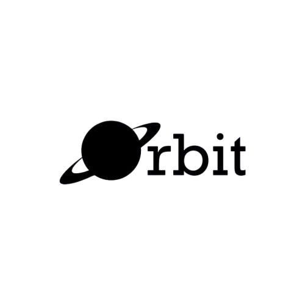
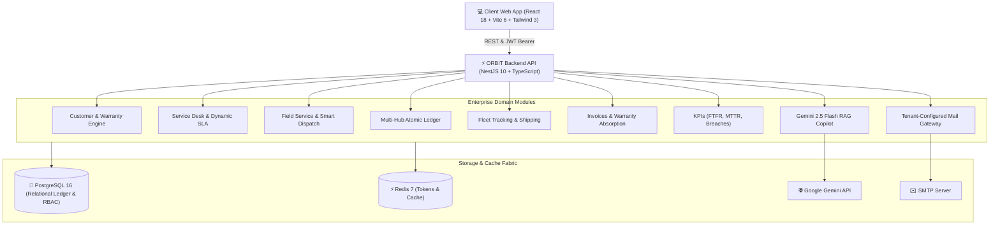
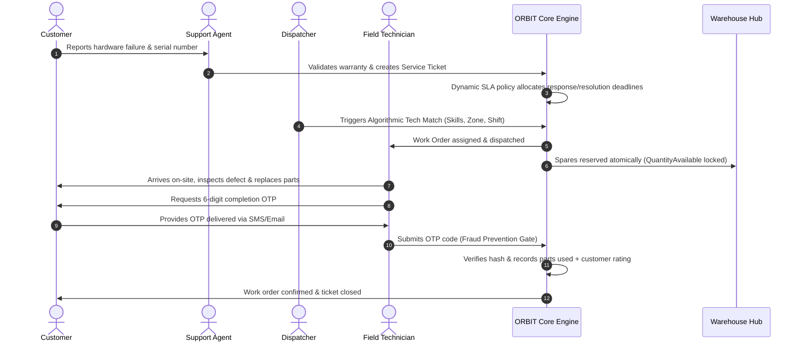
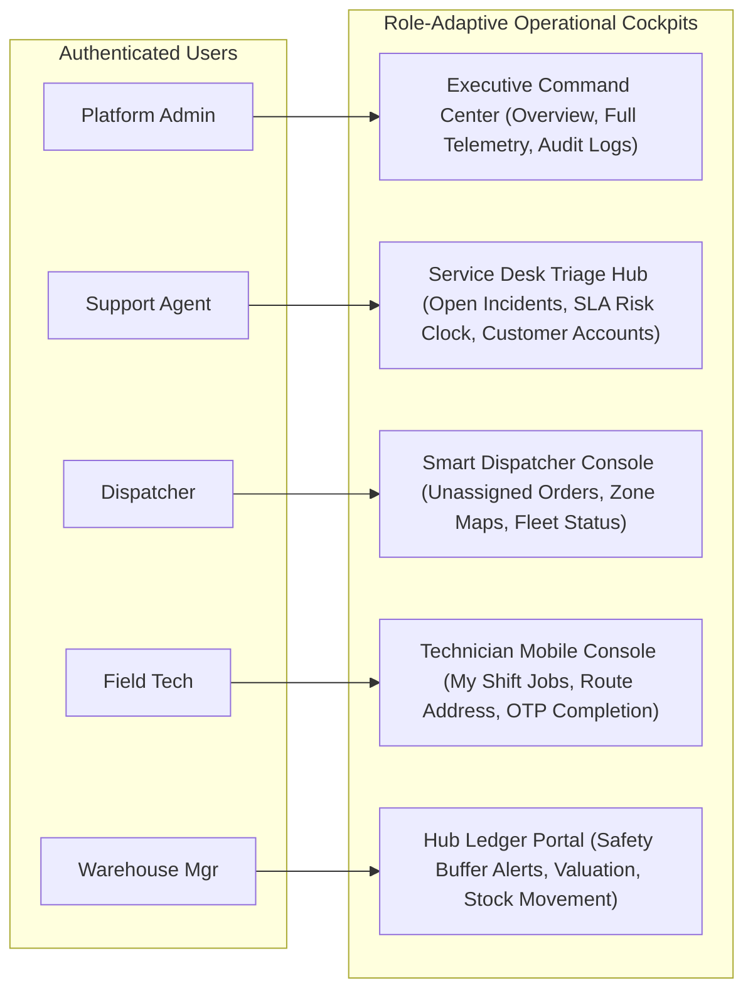
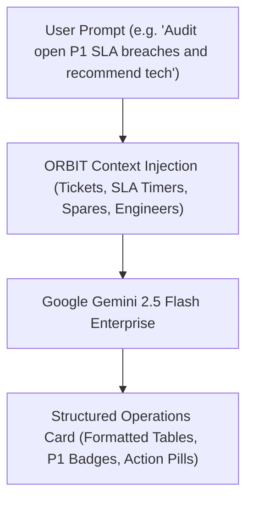

<div align="center">



# ORBIT — Unified Enterprise Resource Operations Platform

**Next-Generation Operational Intelligence coordinating Customer Care, Service Desk SLAs, Smart Field Dispatch, Multi-Hub Warehouses, Fleet Logistics, Financial Billing, and Gemini-Powered AI Telemetry.**

[](https://nodejs.org/)
[](https://nestjs.com/)
[](https://react.dev/)
[](https://www.typescriptlang.org/)
[](https://www.postgresql.org/)
[](https://redis.io/)
[](https://tailwindcss.com/)
[](https://ai.google.dev/)
[](LICENSE)

[Architecture](#-system-architecture) • [Core Workflows](#-operational-lifecycle--workflows) • [RBAC Cockpits](#-role-based-access-control-rbac) • [Copilot AI](#-gemini-ai-operations-copilot) • [Bulk Operations](#-bulk-operations--keyboard-hotkeys) • [Quickstart](#-getting-started)

</div>

---

## 🏛 System Architecture

ORBIT is engineered as a **Domain-Driven Modular Monolith** inside a high-speed Turborepo monorepo. It couples enterprise-grade tenant isolation with sub-second operational queries, atomic inventory ledgering, and real-time SLA deadline monitoring.



---

## 🔄 Operational Lifecycle & Workflows

### 1. End-to-End Enterprise Resolution Pipeline

```mermaid
flowchart LR
    A["👤 Customer Complaint"] --> B["🛡️ Warranty Validation"]
    B --> C["🎫 Service Desk Ticket (SLA Clock Starts)"]
    C --> D["🛠️ Field Work Order"]
    D --> E["📍 Smart Technician Match"]
    E --> F["📦 Spares Reserved at Regional Hub"]
    F --> G["🚚 In-Transit Delivery to Site"]
    G --> H["🔧 On-Site Repair & Diagnosis"]
    H --> I["🔐 Customer OTP Verified"]
    I --> J["🧾 Invoicing / Warranty Absorption"]
    J --> K["📊 Analytics Digest (FTFR & MTTR)"]

    style A fill:#FAF9F6,stroke:#18181B,stroke-width:2px
    style C fill:#EFF6FF,stroke:#2563EB,stroke-width:2px
    style E fill:#F5F3FF,stroke:#7C3AED,stroke-width:2px
    style I fill:#ECFDF5,stroke:#059669,stroke-width:2px
    style K fill:#FFFBEB,stroke:#D97706,stroke-width:2px
```



### 2. Field Service Customer OTP Fraud-Prevention Lifecycle



---

## 👥 Role-Based Access Control (RBAC)

ORBIT enforces strict **multi-tenant isolation** and **granular permission gating** (`45 system capabilities`). Navigation links and dashboard cockpits adapt dynamically to the authenticated persona:



### Granular Capability Matrix
Administrators can customize or create custom roles with real-time capability toggles mapped directly to the backend (`POST /api/v1/identity/roles/:id/permissions`):

| Domain | Key Permissions | Description |
|---|---|---|
| **Identity & Access** | `user.view`, `user.create`, `role.assign_permissions`, `audit.view` | Multi-user administration and compliance logging |
| **CRM & Warranty** | `customer.view`, `product.register`, `warranty.validate` | Serial number registration and warranty engine verification |
| **Service Desk** | `ticket.view`, `ticket.create`, `ticket.update`, `ticket.escalate` | Dynamic SLA policies, complaint triage, and resolution clocks |
| **Field Service** | `work_order.view`, `work_order.assign`, `work_order.complete` | Algorithmic engineer scoring and customer OTP verification |
| **Warehouses** | `inventory.view`, `inventory.reserve`, `inventory.stock.transfer` | Atomic stock reservation and inter-hub replenishment |
| **Logistics** | `shipment.view`, `shipment.dispatch`, `shipment.track` | 3PL carrier tracking, fleet routing, and dispatch manifests |
| **Finance** | `invoice.view`, `invoice.create`, `payment.record` | Split billable charges vs manufacturer warranty absorption |
| **Analytics** | `analytics.view`, `reports.export` | First-Time Fix Rate (FTFR), MTTR, and SLA compliance metrics |

---

## 🤖 Gemini AI Operations Copilot

Connected live to your enterprise telemetry database via **Google Gemini 2.5 Flash** with scoped RAG retrieval:



- **Dual-Width Console:** Expandable side-drawer toggle (`576px` standard to `896px` wide) for deep table inspection.
- **Operational Filters:** Instant tabs for `Incident Triage`, `Smart Dispatch`, `Warehouse & Spares`, `Fleet`, and `Executive Digest`.
- **Structured Rendering:** Syntax-highlighted code blocks with 1-click copy, zebra-striped tables, and auto-highlighted severity badges (`[P1 CRITICAL]`, `[LOW_STOCK]`, `[RESOLVED]`).

---

## ⚡ Bulk Operations & Keyboard Hotkeys

Built for high-volume operations where coordinators manage hundreds of tickets and dispatches:

### Keyboard Hotkeys

| Hotkey | Action | Description |
|---|---|---|
| <kbd>Ctrl</kbd> + <kbd>K</kbd> / <kbd>⌘</kbd> + <kbd>K</kbd> | **Global Command Palette** | Spotlight search to jump to any page or operational action |
| <kbd>Ctrl</kbd> + <kbd>J</kbd> / <kbd>⌘</kbd> + <kbd>J</kbd> | **Toggle Operations Copilot** | Opens or collapses the Gemini RAG sidebar drawer |
| <kbd>?</kbd> | **Shortcuts Cheat Sheet** | Displays interactive hotkey cheat sheet modal |
| <kbd>Esc</kbd> | **Universal Dismiss** | Closes open dialogs, command palettes, or clears bulk selections |
| <kbd>G</kbd> then <kbd>D</kbd> | **Go to Dashboard** | Instant navigation to `/dashboard` |
| <kbd>G</kbd> then <kbd>T</kbd> | **Go to Service Desk** | Jump directly to Tickets list (`/operations/tickets`) |
| <kbd>G</kbd> then <kbd>W</kbd> | **Go to Work Orders** | Jump directly to Field Service Orders (`/operations/work-orders`) |
| <kbd>G</kbd> then <kbd>I</kbd> | **Go to Inventory** | Jump directly to Warehouses & Stock Balances (`/management/inventory`) |
| <kbd>G</kbd> then <kbd>L</kbd> | **Go to Logistics** | Jump directly to Fleet & Shipments (`/management/logistics`) |
| <kbd>G</kbd> then <kbd>F</kbd> | **Go to Finance** | Jump directly to Invoices & Billing (`/management/finance`) |
| <kbd>G</kbd> then <kbd>A</kbd> | **Go to Analytics** | Jump directly to Operational KPIs & FTFR (`/management/analytics`) |
| <kbd>N</kbd> then <kbd>T</kbd> | **New Ticket** | Opens support ticket creation modal |
| <kbd>N</kbd> then <kbd>W</kbd> | **New Work Order** | Opens field service dispatch modal |

### Floating Bulk Operations Dock
- **Service Desk Tickets:** Bulk status transition (`IN_PROGRESS`, `RESOLVED`, `CLOSED`), bulk priority escalation (`P1_CRITICAL`, `P2_HIGH`), and instant CSV report export.
- **Field Service Work Orders:** Bulk technician dispatch, bulk completion, and CSV manifest generation.
- **Inventory Ledger:** Bulk safety stock threshold rebalancing.
- **Logistics Fleet:** Bulk carrier dispatch and tracking status transitions.

---

## 🚀 Getting Started

### 1. Prerequisites
- **Node.js** >= 20 LTS
- **pnpm** >= 9 (`npm install -g pnpm`)
- **Docker & Docker Compose**

### 2. Infrastructure Setup
Start the local PostgreSQL and Redis containers:
```bash
docker compose up -d
```
- **PostgreSQL 16:** `localhost:5433` (mapped from 5432 to avoid host conflicts)
- **Redis 7.2:** `localhost:6380` (mapped from 6379)

### 3. Environment & Database Seeding
```bash
# Copy demo environment variables
cp .env.example .env

# Install monorepo dependencies
pnpm install

# Push Prisma schema and seed initial database
pnpm run db:push
pnpm run db:seed
```

The database seeder automatically initializes:
- `ORBIT Electronics` demonstration tenant
- 45 granular capability permissions across 10 modules
- 9 system roles with pre-configured operational capabilities
- Demo user accounts (password: `admin123`):
  - `admin@orbit.local` (Super Admin)
  - `support@orbit.local` (Support Agent)
  - `dispatcher@orbit.local` (Dispatcher)
  - `tech@orbit.local` (Field Technician)

### 4. Run Development Servers
```bash
# Run both Backend API and Frontend Web simultaneously
pnpm run dev
```

Or run services individually:
```bash
pnpm run dev:api    # NestJS API at http://localhost:5000
pnpm run dev:web    # React Web at http://localhost:5173
```

---

## 🌐 Application Services & Ports

| Service | Port | Local URL | Description |
|---|---|---|---|
| **Frontend Web Console** | `5173` | `http://localhost:5173` | React 18 + Vite 6 + Tailwind 3 Web Application |
| **Backend REST API** | `5000` | `http://localhost:5000` | NestJS 10 Enterprise API Server |
| **OpenAPI / Swagger** | `5000` | `http://localhost:5000/api/docs` | Interactive API documentation and endpoints |
| **Health Check** | `5000` | `http://localhost:5000/api/health` | PostgreSQL + Redis infrastructure status |
| **PostgreSQL Database** | `5433` | `localhost:5433/orbit_db` | Multi-tenant relational operational database |
| **Redis Cache** | `6380` | `localhost:6380` | High-speed cache and token persistence |

---

## 📦 Monorepo Architecture

```
orbit/
├── apps/
│   ├── api/                     # NestJS 10 backend modular monolith
│   │   └── src/
│   │       ├── common/          # Guards (JWT, RBAC), filters, interceptors
│   │       ├── infrastructure/  # Prisma ORM service, Redis connection
│   │       └── modules/         # CRM, ServiceDesk, FieldService, Inventory,
│   │                            # Logistics, Finance, Analytics, Copilot, SMTP
│   └── web/                     # React 18 frontend web application
│       ├── public/              # Favicon and static assets (orbit-logo.png)
│       └── src/
│           ├── components/      # Reusable UI cards, BulkActionBar, CommandPalette, Copilot
│           ├── contexts/        # AuthContext with 1-click demo role switcher
│           ├── hooks/           # useKeyboardShortcuts hook
│           └── pages/           # Role-adaptive dashboards and domain views
├── images/                      # Official ORBIT planetary logo assets
├── packages/
│   └── contracts/               # Shared TypeScript schemas, DTOs, and interfaces
├── prisma/
│   ├── schema.prisma            # Full relational multi-tenant database schema
│   └── seed.ts                  # Comprehensive enterprise seed script
├── docker-compose.yml           # PostgreSQL 16 and Redis 7 container orchestration
└── package.json                 # Monorepo workspace configuration
```

---

<div align="center">

Built with high precision for enterprise resource operations.  
© 2026 ORBIT Technologies Inc. All rights reserved.

</div>
