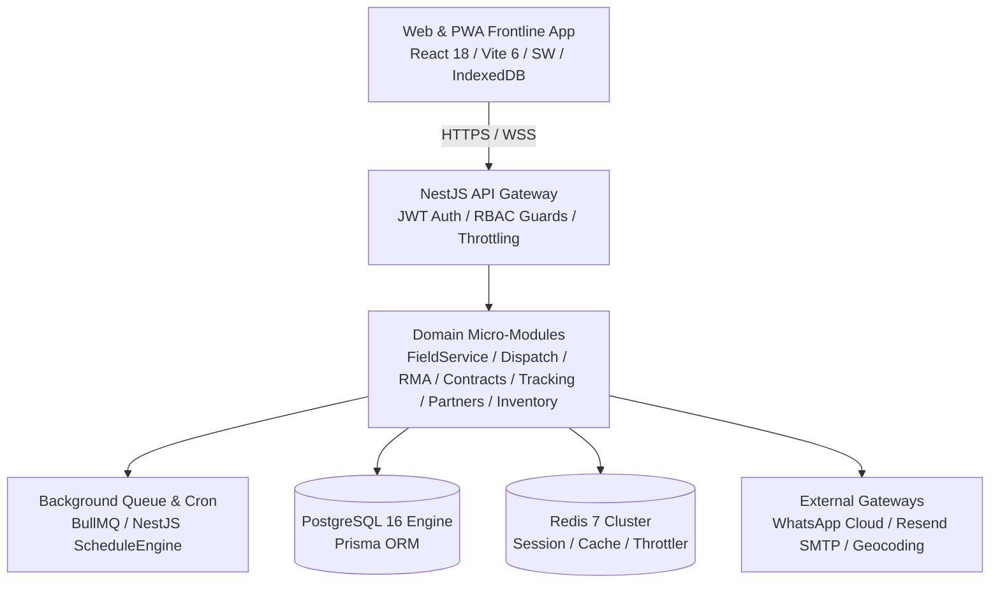
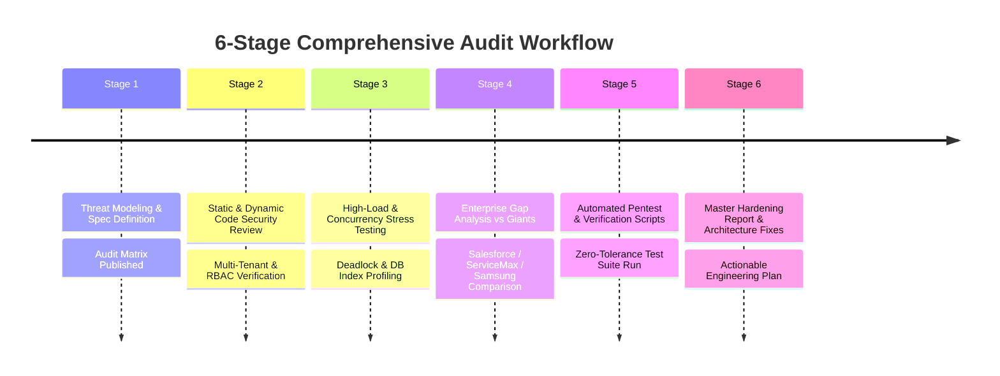

# ORBIT Enterprise Platform - Audit Specification & Evaluation Methodology

**Document Version:** 1.0  
**Classification:** Confidential / Third-Party Technical Audit  
**Author:** Independent System & Cyber-Safety Auditor  
**Date:** 2026-11-18  

---

## 1. Executive Mandate & Purpose

This audit specification establishes the formal criteria, testing vectors, threat models, and architectural standards against which the **ORBIT Unified Enterprise Operations & Field Service Platform** is evaluated. 

The audit evaluates whether ORBIT's software architecture, multi-tenant isolation, data integrity, cryptographic posture, and operational workflows are fit to compete against established enterprise incumbents (**Salesforce Field Service, ServiceMax by PTC, SAP Field Service Management, Oracle Field Service, and Samsung GSPN**) and sustain tier-1 high-throughput production loads.

---

## 2. Audit Scope

The evaluation encompasses the full horizontal and vertical stack of the application repository:

### Specific Target Modules Audited:
1. **Core Gateway & Auth:** `AuthModule`, `UsersModule`, `JwtAuthGuard`, `PermissionsGuard`, RBAC decorators.
2. **Field Service & Dispatch Board:** `FieldServiceModule`, `DispatchModule`, Haversine geocoding, skill matrix validation, collision engine.
3. **Serialized Defective RMA Exchange:** `RmaModule`, dual-serial tracking, barcode generation, depot bench audit reconciliation.
4. **AMC / CMC & PPM Engine:** `ContractsModule`, automated recurrence cron (`@Cron('0 0 * * *')`), renewal pipeline.
5. **Proof of Work & Fraud Defense:** `ProofOfWorkModule`, GPS watermarking, capacitive signature handling.
6. **Customer Tracking & Self-Service:** `TrackingModule`, tokenized public tracking URL, WhatsApp notifications.
7. **Franchisee & ASP Settlements:** `PartnersModule`, category rate cards, TAT bonus and RCR penalty calculation engine.
8. **Mobile Frontline PWA & Offline Engine:** Service Worker caching, IndexedDB transaction queue, optimistic replay mechanism.

---

## 3. Evaluation Standards & Regulatory Benchmarks

The platform is evaluated against five recognized industry frameworks:

### 3.1. OWASP Top 10 (2021) Web Application Security Risks
- **A01:2021-Broken Access Control:** Cross-tenant access (IDOR / Multi-tenant leaking via `organizationId`).
- **A02:2021-Cryptographic Failures:** Secret entropy, plaintext PII, insecure JWT signing, transit encryption.
- **A03:2021-Injection:** SQL injection via raw Prisma queries, command injection, XSS via customer inputs or signatures.
- **A04:2021-Insecure Design:** Missing rate-limits, unauthenticated token exploitation, race conditions in stock reservation.
- **A05:2021-Security Misconfiguration:** Missing security headers (Helmet, CSP), CORS wildcarding, debug exposures.
- **A06:2021-Vulnerable and Outdated Components:** Third-party npm dependencies with known CVEs.
- **A07:2021-Identification and Authentication Failures:** Brute-force OTP attacks, token expiration windows.
- **A08:2021-Software and Data Integrity Failures:** Unvalidated file uploads (PoW photo bypass).
- **A09:2021-Security Logging and Monitoring Failures:** Audit log immutability and sensitive data leakage in logs.
- **A10:2021-Server-Side Request Forgery (SSRF):** Unrestricted webhooks or geocoding calls.

### 3.2. SOC 2 Type II - Trust Services Criteria
- **Security:** Firewalls, RBAC, logical segregation of tenant data.
- **Availability:** Single points of failure, recovery time objectives (RTO), and background worker fault tolerance.
- **Processing Integrity:** Dual-entry inventory balance, financial settlement accuracy without floating point drift.
- **Confidentiality:** Protection of customer addresses, phone numbers, and enterprise customer data.

### 3.3. Data Privacy & Compliance (DPDP Act India 2023 & GDPR)
- Customer Consent & Tracking: Explicit opt-in for live geolocation tracking sessions.
- Data Minimization: Retention policies for customer GPS coordinates and technician location tracks.
- Right to Erasure / Masking: PII redaction capabilities.

### 3.4. High-Load Performance & Scale Baseline
The system must be evaluated for readiness under **Tier-1 Enterprise Load Criteria**:
- **Concurrent Field Force:** 10,000 simultaneously active field service technicians submitting status updates, photos, and signatures.
- **Annual Maintenance Volume:** 500,000 registered contracts generating recurring PPM work orders.
- **Peak Throughput:** 2,500 requests per second (RPS) sustained at API gateway during peak morning dispatch (08:00–10:00).
- **Database Concurrency:** Zero deadlocks during simultaneous technician van inventory transfers and serialized RMA exchanges.

---

## 4. Threat Modeling Methodology (STRIDE)

Every domain interaction is audited against Microsoft STRIDE categories:

| Threat Category | Audit Vector in ORBIT |
| :--- | :--- |
| **Spoofing** | Forging JWT claims, impersonating another tenant or technician, falsifying customer OTP codes. |
| **Tampering** | Altering work order status directly, spoofing GPS coordinates in Proof of Work, tampering with ASP settlement totals. |
| **Repudiation** | Technician denying completed visits; customer denying service receipt without non-repudiable touch signature + OTP audit trail. |
| **Information Disclosure**| Guessing or enumerating `/track/:token` URLs, leaking customer address/phone to unauthorized contractors, exposing error stack traces. |
| **Denial of Service** | Flooding public tracking endpoints, exhausting PostgreSQL connection pool, triggering CPU-bound image watermarking repeatedly. |
| **Elevation of Privilege**| Standard technician role invoking admin financial settlement approvals or dispatch board re-allocations. |

---

## 5. Audit Execution Plan

