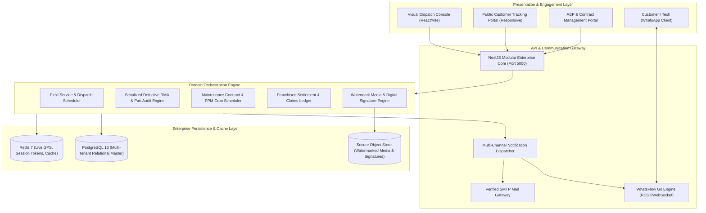
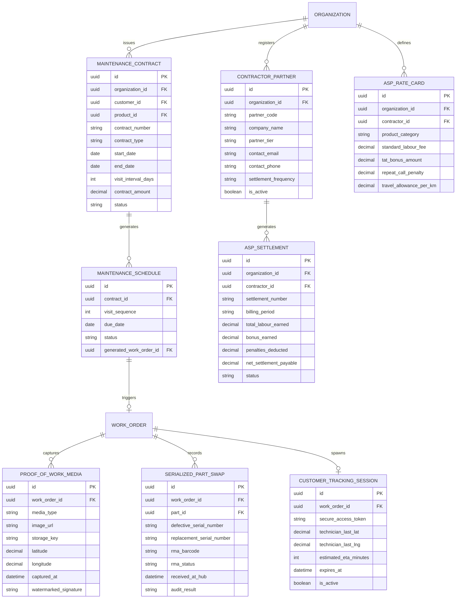
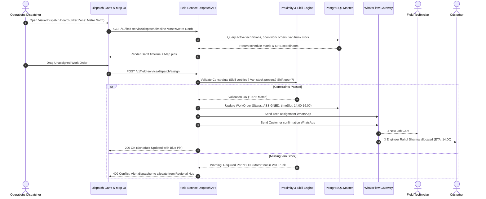
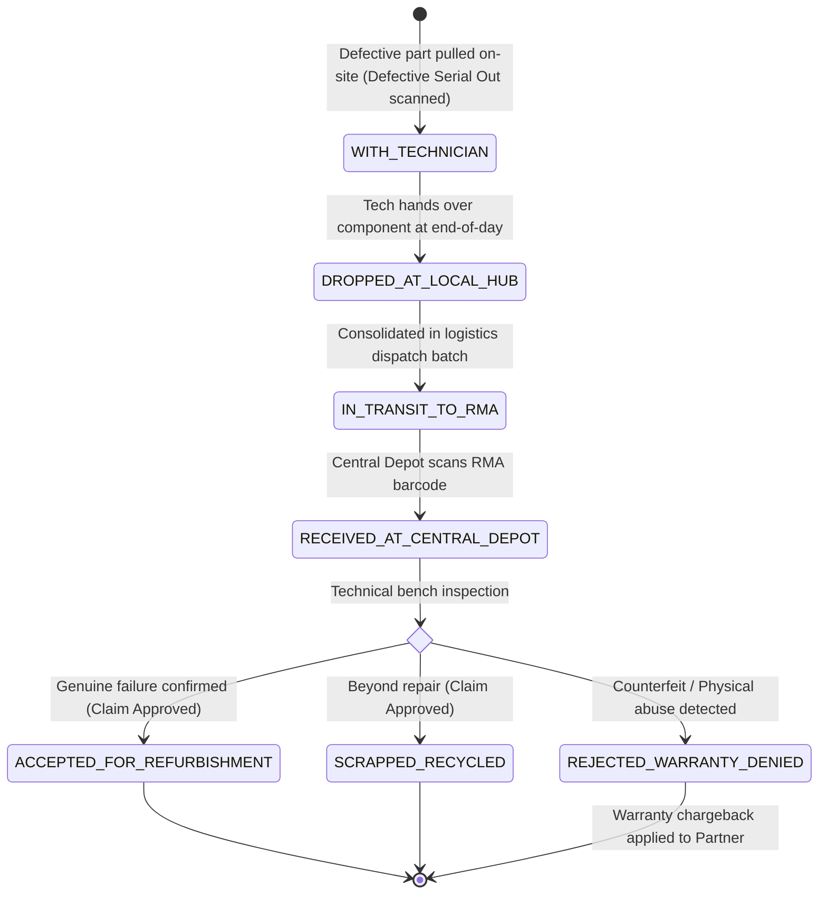
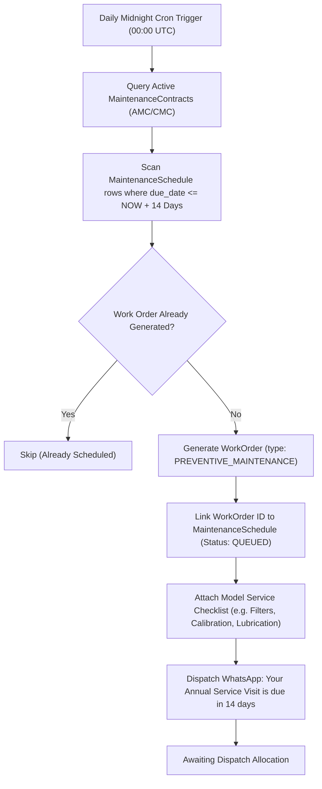
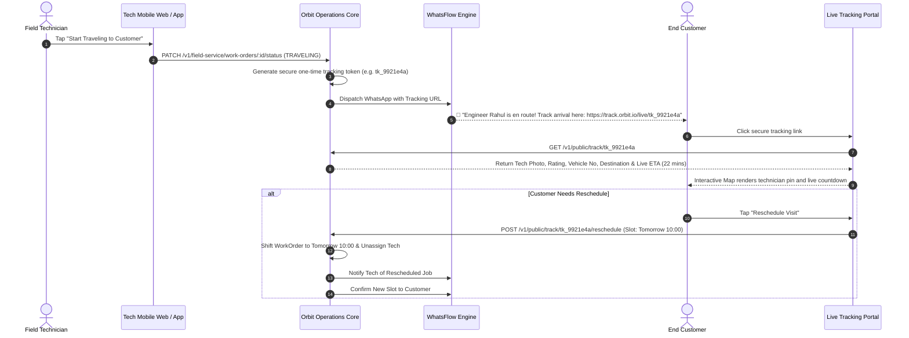

# ORBIT Enterprise Platform: Technical Architecture & System Diagrams
**Document Version:** 2.0.0  
**Classification:** Technical Architecture Specification  
**Status:** Architecture Blueprint

---

## 1. High-Level System Architecture

---

## 2. Extended Database Entity-Relationship (ER) Schema

The following schema extensions model the new enterprise pillars in PostgreSQL via Prisma:

---

## 3. Pillar 1: Visual Dispatch & Proximity Route Allocation Flow

---

## 4. Pillar 2: Serialized Defective RMA Exchange State Machine

---

## 5. Pillar 3: AMC & Preventive Maintenance (PPM) Cron Engine

---

## 6. Pillar 5: Customer Live Tracking & Interactive Rescheduling Flow

